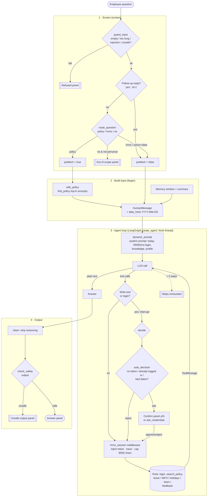

# Agent Pipeline

How one question flows through agent mode (`app/rag/agent.py` → `ask_agent`).

## Steps

| # | Step | Where | Notes |
|---|------|-------|-------|
| 1 | Input guard | `guard_input` | Empty, length, injection regex, safety LLM |
| 2 | Route | `route_question` | `policy` / `hrms` / `no`; follow-ups skip routing; fails open to `policy` |
| 3 | Prefetch | `with_policy` | Policy excerpts only on `policy` route (k = `AGENT_PREFETCH_K`) |
| 4 | Seed messages | `Agent.begin` | Memory + question + resolved dates; new `thread_id` per question |
| 5 | System prompt | `dynamic_prompt` | Rebuilt every model call, so a mid-chat login takes effect |
| 6 | Tool loop | `create_agent` | Up to `AGENT_MAX_STEPS` (5) model→HITL→tool rounds |
| 7 | Approval | `HumanInTheLoopMiddleware` + `decide` | `apply_leave`, `cancel_leave`, `apply_wfh`, `submit_feedback_form`, `login`; resumes via `Command(resume=…)` |
| 8 | Token injection | `hrms_session` | Token from run context, never in messages; results truncated at 8000 chars |
| 9 | Output guard | `clean` + `checked` | Strip reasoning tags, safety check, render panel |
